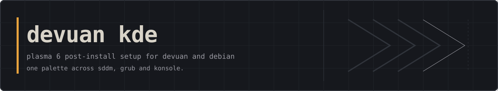

# Devuan KDE

polishes an existing kde plasma install on devuan 6 or debian 13 with codecs, firmware, printing, timeshift and a graphite amber theme across sddm, grub and konsole.

[read the quick start](#quick-start)

| | |
| --- | --- |
| **starting point** | kde is already installed by the distro. this toolkit does not install it. |
| **adds** | codecs, wifi and bluetooth firmware, a software center, printing, a firewall panel and snapshots. |
| **theme** | global theme, icons, konsole, plymouth, grub and sddm all follow one palette. |
| **verify** | `./install.sh` runs every step then verifies. `./run.sh --verify` rechecks state. |

## Quick start

```bash
./run.sh                  # interactive, asks before each step
./run.sh --list           # see every step, its phase, and its default
./run.sh --only 14,27     # just the theme and desktop polish
./run.sh --phase sysmgmt  # only the system-management phase
./run.sh --full --yes     # unattended, every step at its default
./install.sh              # unattended wrapper: --full --yes, then --verify
```

Run it as your **normal user**, never as root and never via
`sudo bash run.sh`. The scripts escalate only the individual commands that
need it, through a helper that prefers `sudo` and falls back to `doas`.

The three standalone utilities (backups, maintenance, skel export) are never
run by the runner. Invoke them directly:

```bash
./run.sh --list-utilities
bash scripts/50-configBackup.sh backup
bash scripts/51-systemMaintenance.sh
```

## Requirements

- Devuan 6 (Excalibur) or Debian 13 (Trixie) with Plasma 6 installed
- `bash`, `coreutils`, `apt`
- A user in the `sudo` or `doas` group
- A running Plasma 6 session, **X11 or Wayland**

> **Both X11 and Wayland are supported**, and Wayland is the expected case.
> Where the two genuinely differ, the toolkit detects it rather than assuming:
> `27-fancyPlasma.sh` skips the X11-only window-management tweaks under Wayland
> and says so instead of writing keys nothing reads, and `47-plasmaPanel.sh`
> builds its layout through the Plasma 6 D-Bus scripting API, which is
> identical on both. `run.sh` prints the Plasma 6.8 Wayland-only migration note
> when it finds itself on X11.

## Layout

```
.
├── run.sh                  # the runner — start here
├── install.sh              # unattended wrapper (--full --yes --verify)
├── Makefile                # release, archive and listing targets
├── VERSION / RELEASE.md    # release metadata
├── themes/
│   ├── _base/tpl/          # templates (colors, konsole, …)
│   └── palettes.sh         # every palette, as palette_<id>() functions
├── assets/
│   └── fastfetch/          # the two shipped fastfetch configs (plain text)
├── iso/                    # ISO build helper
└── scripts/
    ├── [0-9][0-9]-*.sh     # numbered steps + 5x utilities
    ├── lib/
    │   ├── common.sh       # priv, apt, config read/write, shortcuts
    │   └── theme.sh        # palette rendering + Global Theme generation
    ├── skills/             # agent skill files
    └── verifySetup.sh      # post-install verification
```

## Steps

Every step declares its own metadata, which is what `--list` and the phase
filters read. Defaults are what `--yes` answers.

### Phase `core` — runs by default

| # | Script | Default | What it does |
| --- | --- | --- | --- |
| 10 | `10-addUserToGroups.sh` | Y | Add your user to the input/video/render groups (needed for touchpad + GPU accel fixes) |
| 11 | `11-systemUpdate.sh` | Y | Refresh package lists + full-upgrade before anything else (run first on a fresh install) |
| 12 | `12-kdeDebloat.sh` | Y | Debloat KDE Plasma (games/education/PIM/extras) toward a minimal-but-functional install |
| 13 | `13-usefulApps.sh` | Y | Install VLC, TLP (+ ThinkPad battery thresholds), and a few small KDE-completing utilities |
| 14 | `14-plasmaTheme.sh` | Y | The look: Graphite Amber palette + Global Theme, accent, Konsole profile, icons, wallpaper |
| 15 | `15-bootThemeSetup.sh` | Y | Carry the theme to Plymouth (boot splash), GRUB, and the SDDM login screen |
| 16 | `16-touchpadTrackpointFix.sh` | Y | Apply touchpad/trackpoint polling + libinput fixes |
| 17 | `17-hardwareSupport.sh` | Y | Install WiFi/Bluetooth firmware, CPU microcode, and fwupd firmware updates |
| 18 | `18-bluetoothSetup.sh` | Y | Set up the Bluetooth stack, Bluedevil, and audio bridging for headsets/earbuds |
| 19 | `19-multimediaCodecs.sh` | Y | Install audio/video codecs + DVD playback support |
| 20 | `20-firefoxHarden.sh` | Y | Install & harden Firefox ESR with Betterfox + privacy policies |
| 21 | `21-installFonts.sh` | Y | Install Noto, Font Awesome, and JetBrainsMono Nerd Font |
| 22 | `22-terminalButterbash.sh` | Y | Fetch ButterBash at a pinned commit (SHA-verified) into `~/.config`, appending one marked block to `.bashrc` |
| 23 | `23-fastfetchConfig.sh` | Y | Install fastfetch + the bundled Devuan ASCII config (fancy default, plus a minimal variant) |
| 24 | `24-desktopEssentials.sh` | Y | Set up Flatpak/Discover, PackageKit update notifications, printing, Partition Manager, firewall |
| 25 | `25-timeshiftSetup.sh` | Y | Install Timeshift for system snapshots/restore |
| 26 | `26-dolphinServiceMenus.sh` | Y | Right-click menu additions for Dolphin (compress PDF/image, open in VS Code/OpenCode) |
| 27 | `27-fancyPlasma.sh` | Y | Desktop polish: Noto Sans font, borderless maximize, blur, switcher, Night Color, effects |
| 28 | `28-kdeHotkeys.sh` | Y | Add custom Plasma global shortcuts (terminal, Dolphin, editor, system monitor) |
| 29 | `29-aiOpencode.sh` | Y | Install the OpenCode AI coding agent + global hotkey + system skill file |

### Phase `sysmgmt` — `--phase sysmgmt`

| # | Script | Default | What it does |
| --- | --- | --- | --- |
| 30 | `30-networkTimeSync.sh` | Y | Enable NTP time sync via chrony (parks openntpd, harmless if already synced) |
| 31 | `31-ssdTrim.sh` | Y | Weekly fstrim via cron (init-agnostic, works on OpenRC/sysvinit) |
| 32 | `32-updateNotifier.sh` | Y | Lightweight update notifier: cron + notify-send, no background daemon |
| 33 | `33-plasmaPerformance.sh` | Y | Plasma performance tuning: animations, compositing, desktop icons, indexing, autostart trimming |

### Phase `optional` — `--phase optional`

| # | Script | Default | What it does |
| --- | --- | --- | --- |
| 40 | `40-installPhotogimp.sh` | Y | Install GIMP + PhotoGIMP's Photoshop-like layout/theme |
| 41 | `41-installVscodium.sh` | Y | Install the VSCodium editor |
| 42 | `42-vscodiumDevSetup.sh` | Y | Configure VSCodium for C++/Python development |
| 43 | `43-devToolsExtras.sh` | Y | Install curated dev extras: btop, eza, bat, zoxide, Neovim+lazy.nvim, KeePassXC |
| 44 | `44-gamingSetup.sh` | Y | Install Heroic Games Launcher / Steam / Wine |
| 45 | `45-vesktopTelegram.sh` | Y | Install Vesktop (Discord client) / Telegram |
| 46 | `46-applyThemes.sh` | Y | Swap the active palette anytime (Konsole + Plasma color scheme + accent + Global Theme, 12 palettes) |
| 47 | `47-plasmaPanel.sh` | Y | Rebuild the panel: one floating bottom bar (launcher, pinned apps, tasks, pager, tray, clock) (`--tray-panel`, `--extras`, `--dodge-windows`, `--restore`, `--dry-run`) |
| 48 | `48-plasmaAddons.sh` | Y | Plasma 6 plugins, KRunner runners, extra image formats, apps (Debian-first), user kpackages |

### `standalone` utilities — never run by the runner

| # | Script | What it does |
| --- | --- | --- |
| 50 | `50-configBackup.sh` | Back up / list / restore the KDE + user config this toolkit touches |
| 51 | `51-systemMaintenance.sh` | Periodic cleanup: autoremove, autoclean, dead symlinks, optional full-upgrade |
| 52 | `52-exportToSkel.sh` | Copy curated per-user defaults to `/etc/skel` (ISO bake only — the one script that runs as root) |

## Fetched at install time

Nothing third-party is vendored. Optional pieces are downloaded only when the
step that needs them runs; the Plasma theme itself is always generated locally.

| What | From | Pin |
| --- | --- | --- |
| ButterBash | `codeberg.org/justaguylinux/butterbash` | commit `ae194a92923c922e1baaede280940a5a256da99f`, tarball SHA256 `0989771e…96c9` |
| Moe Dark Global Theme | pinned mirror via `scripts/lib/moe.sh` | SHA256 verified at download when the `moe-dark` palette is applied |

`22-terminalButterbash.sh` fetches a **pinned commit**, not a branch, so two
runs of the step cannot silently install different code, and it refuses to
install on a hash mismatch. It also does **not** run upstream's `install.sh`:
that script overwrites `~/.bashrc` and moves `~/.config/bash` aside. Instead the
step copies `bash/*` into `~/.config/bash`, keeps upstream's `bashrc.example` at
`~/.config/butterbash/bashrc` (outside the directory that rc globs, so it cannot
source itself), and appends **one marked block** to `~/.bashrc` — re-running
refreshes that block in place and never touches your own lines.

To move ButterBash forward, override all three at once:

```bash
BUTTERBASH_REF=<commit> BUTTERBASH_SHA256=<sha256-of-tarball> bash scripts/22-terminalButterbash.sh
```

The fastfetch configs are the opposite case: they ship **in** the repo, as plain
text, at `assets/fastfetch/`. The Devuan logo is fastfetch's own built-in ASCII
art (`"logo": {"type": "builtin", "source": "devuan"}`), so no image is
committed and the art always matches the installed fastfetch version.

## Theming

Every palette is a `palette_<id>()` function in `themes/palettes.sh` — one file
rather than one directory per palette — rendered through the templates in
`themes/_base/tpl/`. Adding a palette means adding an id to `PALETTE_IDS` and one
function; nothing else needs touching. The default **Graphite Amber** palette
uses a graphite canvas (`#16181D`) with an amber accent (`#E8A33D`);
`graphite-amber-cool` and `graphite-amber-light` keep the same accent on
cooler and lifted surfaces. The old `darkmatter` and `darkmatter-orange` palettes remain selectable as legacy options.

```bash
bash scripts/46-applyThemes.sh            # interactive picker
bash scripts/46-applyThemes.sh graphite-amber # apply one directly
bash scripts/46-applyThemes.sh otto       # OttoRed
```

### OttoRed, and what it does to an installed Otto

`otto` is a dark palette with Otto's signature red. The Otto theme itself is
**not** in this repository and cannot be fetched by a script — it lives on
`store.kde.org`, which is behind an Anubis challenge, so installing it is a
Discover/GUI step. Nothing here is broken by that: with Otto absent, `otto`
applies as a complete standalone palette and says what it could not find.

With Otto installed, `scripts/lib/otto.sh` recolours what it finds in place,
from copies, and leaves the original package untouched:

- **Global Theme** — copied to `~/.local/share/plasma/look-and-feel/OttoRed`
  with `contents/layouts/` and `contents/widgets/` **removed**. That removal
  is the point: a Global Theme that ships layouts replaces the panel, which
  would silently undo step 47 along with the user's pinned apps. Otto's
  `Authors` and `License` are preserved; the `Id` and `Name` become the
  palette's, so a re-apply updates that copy instead of colliding with the
  installed one.
- **Colour scheme** — key-by-key semantic mapping onto the palette
  (`Background`, `WindowText`, `SelectionBackground`, …), not a blind
  substitution.
- **Kvantum** — `.conf` files recoloured across all four notations IM/Qt use
  (`r,g,b`, `rgb(r,g,b)`, `#rrggbb`, with the `#`). **SVGs are copied
  untouched**: recolouring Qt's generated SVG state cache is how a theme ends
  up half-tinted, and Kvantum rebuilds that cache itself.
- **Konsole** — section-aware recolour (`Color0`–`Color15`, `Background`,
  `Foreground`, `ColorTab`, …).
- **Window decoration** — Otto's decoration is registered in the Global
  Theme's `contents/defaults`, replacing only the `[kwinrc]` block so the
  section after it survives.

Every directory this toolkit writes carries a `.devmkde-generated` marker, and
discovery skips it. Without that, the second `apply_palette otto` finds its own
output as its "installed Otto" — the generated wrapper declares the name
`Otto Red`, and the Kvantum copy's id ends in the palette name, so each run
compounded the last.

Palettes are one file each and the renderer is shared: **12 ship in-tree**
(`graphite-amber` (default), `graphite-amber-cool`, `graphite-amber-light`;
legacy/optional: `darkmatter`, `darkmatter-orange`, `moe-dark`, `nord`, `dracula`,
`tokyo-night`, `gruvbox`,
`solarized`, `otto`).

`14-plasmaTheme.sh` writes a real Plasma 6 Global Theme — `metadata.json`
plus `contents/defaults`, which is how Plasma 6 actually applies a theme: it
carries `[kdeglobals][General] ColorScheme=<Name>` and Plasma writes that into
`kdeglobals` on apply. No stock theme (`org.kde.breezedark.desktop`) ships a
`contents/colors` or a `layout.js`, and Plasma 6 reads neither — so they are
never load-bearing. There is no `layout.js` and no `contents/layouts/`; a
`contents/colors` entry *is* written as a real file copy (never a symlink, which
Plasma 6 kpackages do not support) purely so older tooling that still looks for
it keeps working. Deleting it changes nothing Plasma reads. It also writes the Konsole profile, icon theme, accent and a
generated wallpaper. The GTK side uses the stock `Adwaita-dark` base, and the
boot/login assets are generated locally by `15-bootThemeSetup.sh`; no theme
tarball or binary asset is committed to this repository.

## Environment variables

| Variable | Effect |
| --- | --- |
| `DEVMKDE_ASSUME_YES=1` | Answer every prompt with its default |
| `DEVMKDE_PRIV=sudo\|doas` | Force a specific privilege escalator |
| `DEVMKDE_SKIP_APT_UPDATE=1` | Skip every `apt-get update` (and the runner's own) |
| `DEVMKDE_ISO_BUILD=1` | Relax privilege requirements for ISO bakes |
| `BUTTERBASH_REF` | Commit-ish `22-terminalButterbash.sh` fetches (default: the pinned commit above) |
| `BUTTERBASH_URL` | Full archive URL, if you want a mirror instead of Codeberg |
| `BUTTERBASH_SHA256` | Expected archive hash — **set this with `BUTTERBASH_REF`**, or the pinned hash is checked against a different archive and the install fails closed |

## How escalation works

`scripts/lib/common.sh` owns it. `priv`, `priv_n` and `priv_as` resolve the
escalator **once** — sudo if present, otherwise doas — and cache the result.
`DEVMKDE_PRIV` overrides the choice. There is no bare `sudo` anywhere in
`scripts/`.

The one script that runs as root is `52-exportToSkel.sh`, and the generated
cron checker in `32-updateNotifier.sh` resolves its own helper because it ships
to `~/.local/bin` without the toolkit around it.

## Verification

```bash
bash scripts/verifySetup.sh
```

Read-only check of what the toolkit expects to find. Optional items are
reported as optional rather than failed, so it is meaningful on a fresh
minimal install too.

## Adding a step

Create `scripts/NN-camelCase.sh` with the three metadata headers, source
`scripts/lib/common.sh` for `priv`/`install_pkgs`/`ask`/`log_*`, add it to the
step table in this README, then check it with `bash -n` and
`bash run.sh --list`.

## Safety notes

- Backups (`*.bak.<timestamp>`) precede every destructive config write.
- Nothing is force-purged blindly: each apt action checks what is actually
  installed first, so scripts are safe to re-run.
- The runner keeps its state log at `~/.local/state/devuan-kde-setup/last-run.log`.
- `12-kdeDebloat.sh` removes Plasma's bundled games, education and PIM apps.
  It defaults to **Y** but it is the one step worth reading before answering.

## License

GPL-2.0-or-later. See [LICENSE](LICENSE). Vendored components keep their own
license files.

## Related repos

- [DebianSway](https://github.com/SOSMLG/DebianSway): Sway on Debian/Devuan.
- [DevuanSway](https://github.com/SOSMLG/DevuanSway): Sway on Devuan with OpenRC.
- [DevuanDwm](https://github.com/SOSMLG/DevuanDwm): minimal dwm desktop for Devuan.
- [devuan-cinnamon-setup](https://github.com/SOSMLG/devuan-cinnamon-setup): Cinnamon on Devuan.
- [XfceMlg](https://github.com/SOSMLG/XfceMlg): XFCE desktop toolkit.
- [ThisForOldPc](https://github.com/SOSMLG/ThisForOldPc): setup for old PCs.

## Repository standard

This repo follows the SOSMLG standard: [contributing](CONTRIBUTING.md), [security](SECURITY.md), [changelog](CHANGELOG.md). Local workflow: [English guide](https://github.com/SOSMLG/.github/blob/main/docs/GIT_GUIDE.md) / [Arabic guide](https://github.com/SOSMLG/.github/blob/main/docs/GIT_GUIDE.ar.md). Visual standard: [theme](https://github.com/SOSMLG/.github/blob/main/docs/THEME.md) / [الطابع البصري](https://github.com/SOSMLG/.github/blob/main/docs/THEME.ar.md).
